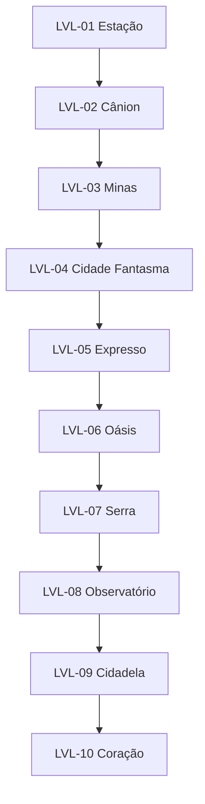

# Fluxo macro e dependências de campanha

**Nota:** o diagrama textual acima é especificação, não requer dependência de CDN. O portal contém um fluxograma próprio, interativo e offline.

## Dependências persistentes
`knows_mara_mother=true` após LVL-08; `ze_confessed=true` após LVL-07; `water_channels_safe` exige os quatro canais no LVL-09; `finale_restorative` requer segredos do Oásis e Observatório. Nenhuma flag opcional bloqueia o final padrão.
