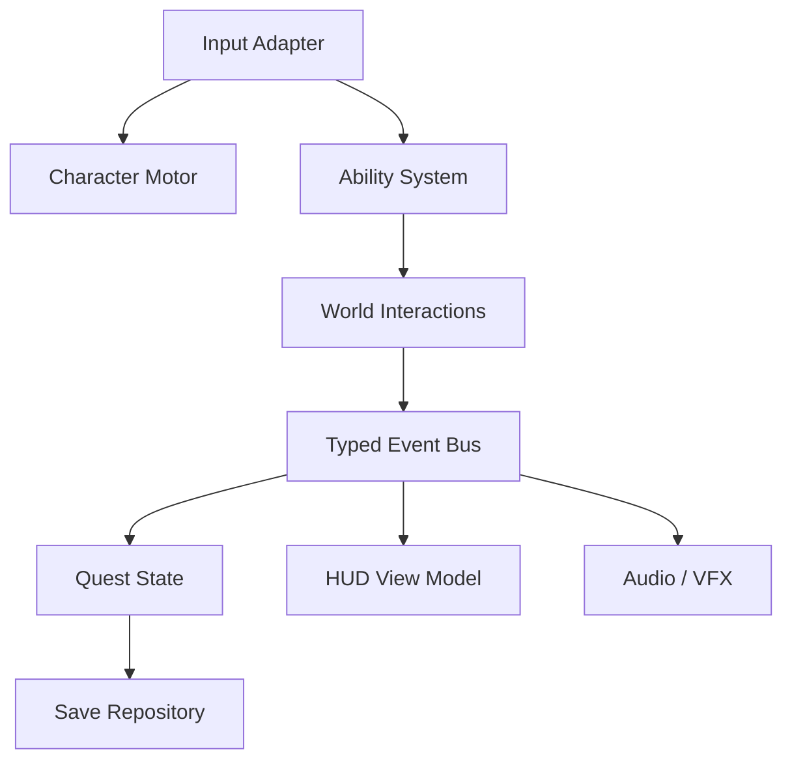

# Componentes, interfaces e contratos

**ICharacterMotor** calcula locomoção, independente de canvas. **IAbility** expõe pré-condição, execução e interrupção. **IQuestStore** é a única fonte do estado da missão. **ISaveRepository** persiste snapshot com schemaVersion; `IEventBus` publica eventos tipados com ownership explícito.

A UI não destrava missões diretamente; cutscenes observam eventos com skip seguro. Objetos de cena são adaptadores, não núcleo da campanha.
