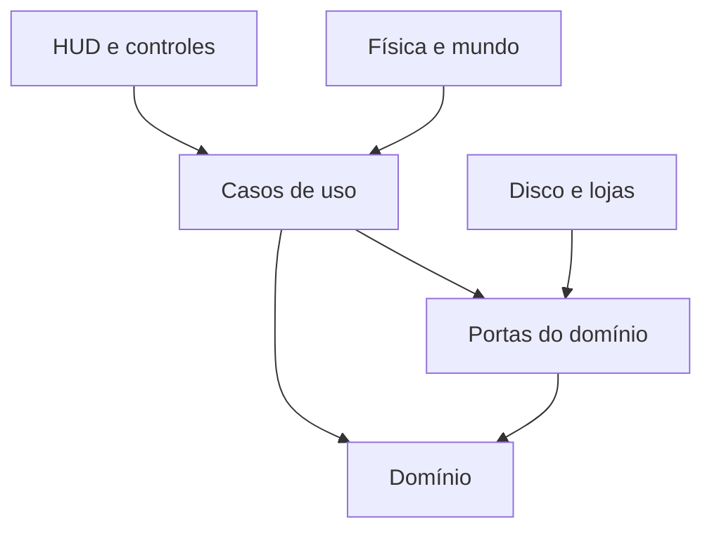

# Módulos, autoridade e contratos de integração

## Estrutura entregue e estrutura alvo

Nesta V4, Domain contém sessão/sinais, QuestState, DTO legado, IAbility e contratos/política/verificador de licença puros. Runtime contém MonoBehaviours, ScriptableObjects, câmera, I/O e Input System. Editor contém geração do laboratório/build de desenvolvimento. Testes EditMode dependem de Domain. Runtime é camada de transição: separar Application e Infrastructure quando os casos de uso reais existirem, sem criar dezenas de assemblies vazios.

QuestState deixou de receber QuestDefinition (ScriptableObject) para receber IEnumerable<string> de flags; QuestRules no Runtime faz a ponte. Isso elimina uma dependência de Unity que estava escondida no domínio anterior. Ao portar chamadas próprias, trocar Ready(definition) por QuestRules.IsReady(state, definition). A API de I/O segue schema 1 enquanto DEV-08/09 implementam o schema3; a movimentação de arquivos não corrige essa migração por si só.

Diagrama de dependências alvo. O conjunto de referências dos asmdefs entregues é menor; não declarar como implementados os casos de uso ainda descritos abaixo.

| Caso de uso | Entrada validada | Resultado e dono do estado | Falha / cancelamento |
|---|---|---|---|
| StartSession | slot, nível e modo de acesso | SessionReady após restaurar snapshot | Slot inválido retorna ao menu sem criar campanha |
| LoadLevel | LevelId conhecido e checkpoint permitido | WorldReady com entidades/flags aplicadas | Timeout cancela input; descarrega parcialmente sem salvar progresso falso |
| CompleteObjective | flag permitida no contexto e pré-condições | Grant único de flag; UI apenas observa | Repetição retorna AlreadyApplied; flag desconhecida é diagnóstico |
| SaveCheckpoint | snapshot coerente e revisão atual | Persisted(revision) após promoção confirmada | I/O falha mantém anterior; notificação sem sucesso fictício |
| UseAbility | ator, alvo, alcance e fase de sessão | Comando aprovado e evento de apresentação | Alvo some: interromper, limpar hitboxes/corda e liberar input |
| SwitchHero | chão seguro, espaço e capítulo | Novo herói/mascote com snapshot preservado | Bloqueado durante resgate/estado incompatível; mensagem curta |
| RenewAccess | desafio, prova de instalação e rede | Janela autenticada pelo verificador | Falha de rede não estende prazo por conta própria |

Cada operação assíncrona recebe cancelamento. UI não persiste flags; ScriptableObjects guardam definição, estado de sessão fica separado. Event handlers são liberados ao descarregar; animação cancelada não pode deixar dano ativo. Não usar string de nome visível para localizar personagem: IDs/slug são fonte de vínculo.

## Física e tempo

Baseline usa CharacterController 3D no plano XY; não misturar Rigidbody2D e colisores 3D no mesmo ator. Movimento/câmera/Animator precisam de responsabilidade clara. Escolher a cadência do motor com o adaptador e medir input; evitar multiplicar velocidades por deltaTime duas vezes. Pausa de gameplay, perda de foco e suspensão do SO são eventos diferentes e exigem testes próprios. Relógio de licença não usa Time.time como fonte de prazo comercial.

O GamePhaseMachine incluído ainda é mínimo: recuperação de Loading para Menu, cancelamento e encerramento de sessão devem ser estendidos na tarefa DEV-02 com testes. Não contornar falha de transição forçando Playing na UI.
